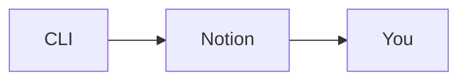

# Notion workspace from the CLI

These Node.js 20+ scripts use the official Notion SDK and run the same on Linux and Windows. No server, webhook, or background worker is involved. An agent posts milestones while it is actively working in a CLI session. Comments you add in Notion do **not** wake the CLI; ask the agent to run `sync` when you want it to read your feedback.

## Boards

| Name | Path relative to your root | Access |
| --- | --- | --- |
| `tasks` | `Development/Tasks Tracker` | create, comment, status, move |
| `issues` | `Development/Issue Tracking` | create, comment, status, move |
| `failures` | `Development/Pipeline failures` | create, comment, status, move |
| `decisions` | `Development/Decision Register` | create, comment |
| `documents` | `Development/Document Hub` | create, comment |
| `features` | `Business/Feature Requests` | read only |
| `roadmap` | `Business/Product Roadmap` | read; **each** write needs your explicit permission |

`boards` prints the discovered IDs, live title field, statuses, valid option values, disabled flags and unavailable-board reasons. `boards --definitions` shows the supported paths and access rules offline, without a token or root. The ID after `?v=` in a Notion link is a view, not a root page or data source.

## Setup

From the project root, run `npm ci --prefix docs/notion` once. Configure the ignored `.env.private`, or set these environment variables:

```text
NOTION_TOKEN=...
NOTION_ROOT_PAGE="Travel Assistant"
```

The root can be a page name, UUID or full Notion page URL. Name matching is exact after trimming spaces and ignoring case; if multiple pages match, the command lists their IDs/URLs and requires one of those instead. Names are resolved on every invocation, so replacing a root with a new page of the same name never reuses the old page's cache.

Share the root and its content with the integration, then run:

```text
node --env-file=.env.private docs/notion/cli.mjs discover
```

Discovery only reads Notion. It finds the paths above, retrieves their data-source schemas and saves `.notion-discovery/<root-id>.json` locally. **The entire directory and temporary files are git-ignored; never commit them.** There are no production IDs in the scripts. To change projects, change `NOTION_ROOT_PAGE` and run `discover` again.

Missing or ambiguous boards are reported and disabled; other boards remain usable. Optional fields that are missing or of the wrong type disable the corresponding flags. Writes revalidate the role's location and schema; if a database moves or options change, rerun `discover`. The layout and mapped property names (`Status`, `Priority`, `Task type`/`Type`, etc.) remain the contract; this does not infer arbitrary workspace semantics. Title fields and option values are discovered live. A linked view of a database outside the root does not make that database part of the root.

All content commands are restricted to this root and its real descendants, including direct-ID reads, edits, comment discussions, relation targets and move destinations. `tree` no longer includes unrelated pages accessible to your token.

The integration needs these capabilities:

- read content and read comments;
- insert comments, for milestones;
- update content, for statuses and moves (moves also need edit access on both boards);
- insert content, for creating entries.

A permission error is reported; it is never treated as success.

## Markdown only

All page and comment content is Markdown. Pass it inline or with `--file path.md` (relative to the current directory; UTF-8, up to 500 KB). Notion converts Markdown to its own blocks: headings, lists, to-dos, tables, code, quotes, callouts and equations. Comments support inline formatting only (bold, italic, code, links) and are limited to 2,000 characters. If inline Markdown starts with `-`, put `--` before it, or use `--file`.

### Diagrams

Use a fenced Mermaid block; Notion renders it as a diagram:

````markdown

````

## Commands

Run these from the project root in any OS's terminal, quoting arguments that contain spaces:

```text
node --env-file=.env.private docs/notion/cli.mjs boards
node --env-file=.env.private docs/notion/cli.mjs discover
node --env-file=.env.private docs/notion/cli.mjs tree [--rows]
node --env-file=.env.private docs/notion/cli.mjs page "Legal"
node --env-file=.env.private docs/notion/cli.mjs page "Business/Partnerships"
node --env-file=.env.private docs/notion/cli.mjs page edit "Legal" --append "## New section"
node --env-file=.env.private docs/notion/cli.mjs page edit "Legal" --find "old text" "new **text**" [--all]
node --env-file=.env.private docs/notion/cli.mjs page edit PAGE_ID --replace --file page.md
node --env-file=.env.private docs/notion/cli.mjs list tasks 20 [NEXT_CURSOR]
node --env-file=.env.private docs/notion/cli.mjs show tasks PAGE_ID
node --env-file=.env.private docs/notion/cli.mjs sync tasks PAGE_ID
node --env-file=.env.private docs/notion/cli.mjs create tasks "Title" --file body.md --priority High --type Bug --effort Small --description "Short" --blocked-by ID1,ID2
node --env-file=.env.private docs/notion/cli.mjs create issues "Title" "Inline **Markdown**" --status Backlog --type Bug --priority Low
node --env-file=.env.private docs/notion/cli.mjs decision "Title" --file decision.md --category Planning
node --env-file=.env.private docs/notion/cli.mjs document "Title" --file doc.md --category Proposal --category "Strategy doc"
node --env-file=.env.private docs/notion/cli.mjs comment tasks PAGE_ID "Started work" [--discussion DISCUSSION_ID]
node --env-file=.env.private docs/notion/cli.mjs move tasks PAGE_ID "In progress"
node --env-file=.env.private docs/notion/cli.mjs move issues PAGE_ID --to tasks [--status "Not started"]
```

- **`tree`** prints the configured root's page and database hierarchy with IDs. Add `--rows` to include database entries. Only content shared with the integration appears.
- **`page`** reads an in-root page as Markdown by its page ID, its title, or a `parent/title` path of any depth. The configured root's title is optional, and titles are matched case-insensitively with surrounding spaces ignored. Structural pages are resolved first without loading database rows; use a database-qualified path such as `"Tasks Tracker/Setup"` to select a row with the same title as a structural page. An ambiguous match lists candidate paths instead of guessing. Reading by ID avoids row indexing altogether.
- **`page edit`** edits the content of any page after your approval, including Feature Requests and Roadmap entries; see [Editing pages](#editing-pages).
- **`show`** returns an entry's key properties, its Markdown body and its comments.
- **`list`** returns a `next_cursor`; pass it after the limit to fetch the next page of results.
- **`create`** defaults to a status only when the schema has exactly one option in its `To-do` group; otherwise pass `--status`. Every option is checked against the discovered schema. Leading emoji are optional, so `--type Bug` matches `🐞 Bug`. `--blocked-by` IDs must be pages on the discovered Tasks board, whose relation must also point to that board. `decision` and `document` require Markdown content.
- **`move` with a status** changes the entry's column.
- **`move` with `--to`** moves the entry to another work board. The page keeps its ID, body and comments. Its status is kept when the target board has it; otherwise use an unambiguous initial status or pass `--status`. Priority and Type are carried over when their values exist on the target. Fields the target board lacks (for example `Effort level`, `Description`, `Blocked by`/`Blocking`) are lost, and the command lists them under `dropped`.

### Editing pages

`page edit <path|page_id>` takes exactly one mode and Markdown content (inline or `--file`):

- `--append` adds the Markdown to the end of the page;
- `--find "<exact text>"` replaces that text, which must appear exactly once, unless you pass `--all`. An empty replacement (`""`) deletes it. Copy the exact text from the `page` output, because matching is done on the page's Markdown;
- `--replace` replaces the whole page. Child pages and databases are protected: keep their `<page url=…>`/`<database url=…>` lines from the `page` output, or Notion rejects the edit. Comments attached to replaced blocks may be lost.

Every edit takes two steps. Without `--approve`, the command writes nothing and prints a line diff (`-` removed, `+` added, `…` unchanged lines omitted), any warnings, and an `approve` token. Once you approve that exact diff, the agent reruns the **same** command with `--approve=<token>`. The token covers the page, the mode, the content and the page's current Markdown. It is rejected if anything differs, including someone editing the page in the meantime; in that case, preview again. The agent must show you the preview and wait for your approval; the token only prevents stale or accidental writes. The edit command changes page content only; properties are changed with `status`/`move`.

A page created moments ago may not be found by title for a few seconds, because Notion's search index lags. Use its ID instead.

### Feedback sync

The first `sync` shows existing human comments. Later syncs show only new or edited human comments. Comments posted through this CLI are excluded; they are recorded locally because a personal access token attributes them to you. State is namespaced by root in the ignored `.notion-sync-state.json`. Old unscoped checkpoints are not reused, so the first sync after upgrading may show earlier comments again. Don't run overlapping syncs; use `show` to reread everything.

## Agent workflow

When you start work in the CLI, give the agent the board and page ID. It reads the entry and its comments, posts a concise start message, then posts blockers and questions as comments. On completion, it posts the result and updates the entry's status. It records genuine architecture or product decisions in `decisions`, and regular documentation in `documents`. It never copies secrets or large logs into Notion.

For Product Roadmap, get your explicit approval for the specific change first, then:

```text
node --env-file=.env.private docs/notion/cli.mjs roadmap-status PAGE_ID "Planned" --approve=PAGE_ID:Planned
node --env-file=.env.private docs/notion/cli.mjs roadmap-comment PAGE_ID "Approved update" --approve=PAGE_ID
```

The `--approve` flag guards against accidental writes; it is **not** a substitute for asking you.

## Tests

The optional [shared agent toolkit](../agent-toolkit/README.md) is managed separately from these Notion utilities. Its profile switcher must not change `.env.private`, discovery settings or sync checkpoints; a regression test checks that boundary.

Run `npm test --prefix docs/notion`. The tests use a mocked client and make no network calls. The `Notion scripts tests` GitHub Actions workflow (`.github/workflows/notion-scripts.yml`) runs them, plus an audit and a syntax check, on Linux and Windows with Node 20 and 22 whenever `docs/notion/` changes.

## Not included

- Webhooks and unattended or automatically resumed agents. These would need a public HTTPS endpoint, signature verification, a persistent worker, event deduplication and job routing.
- Uploading local image files.
